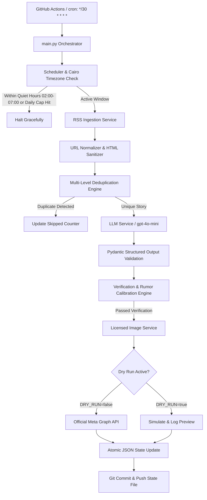

# ⚽ Autonomous Football News Publisher for Facebook (نظام النشر الآلي لأخبار كرة القدم)

An enterprise-grade, autonomous, production-oriented football news publishing platform designed to run 24/7 on GitHub Actions without requiring a local machine.

The system ingests breaking sports news from verified RSS feeds, uses an LLM (OpenAI API) to classify, filter, and summarize stories, generates captivating posts in natural Egyptian Arabic (اللهجة المصرية العامية), attaches copyright-compliant licensed images, and publishes directly to Facebook using the official Meta Graph API.

---

## 📑 Table of Contents

1. [Architecture Overview & Data Flow](#architecture-overview--data-flow)
2. [Key Features & Safeguards](#key-features--safeguards)
3. [Repository Layout](#repository-layout)
4. [Prerequisites](#prerequisites)
5. [Local Development Setup](#local-development-setup)
6. [Meta Developer & Facebook Page Configuration](#meta-developer--facebook-page-configuration)
7. [OpenAI Configuration & Prompt Safeguards](#openai-configuration--prompt-safeguards)
8. [GitHub Actions & Scheduling (24/7 Cloud Execution)](#github-actions--scheduling-247-cloud-execution)
9. [Dry-Run & Safe Staging Mode](#dry-run--safe-staging-mode)
10. [Operating Costs & Token Estimations](#operating-costs--token-estimations)
11. [Troubleshooting & Common Errors](#troubleshooting--common-errors)
12. [Credential Rotation & Security Best Practices](#credential-rotation--security-best-practices)

---

## 🏗️ Architecture Overview & Data Flow



### The 13 Pipeline Stages
1. **Source Discovery**: Polls Egyptian, African, and European feeds (`feeds.json`).
2. **Normalization & Sanitization**: Strips tracking parameters (`utm_source`, `fbclid`), cleans HTML and scripts.
3. **Freshness & Integrity Validation**: Rejects malformed links and articles older than 24 hours.
4. **Multi-level Deduplication**: Canonical URLs, content SHA-256 hashes, and token sequence similarity.
5. **LLM Classification & Quality Evaluation**: Assigns category, priority (0-100), and confidence.
6. **Fact-Checking & Rumor Guard**: Unconfirmed transfer rumors are calibrated with "بحسب تقارير متداولة..".
7. **Egyptian Arabic Caption Crafting**: Compelling hook, accurate facts, proper emojis, source attribution.
8. **Caption Length & Policy Check**: Verifies length (50-2000 chars) and absence of hallucinations.
9. **Authorized Image Selection**: Selects royalty-free Pexels photos or authorized default illustrations.
10. **Meta Graph API Publishing**: Uses official `/v20.0/{page-id}/photos` endpoint with never-expiring Page Token.
11. **State Persistence**: Atomic JSON storage preserving post IDs, image IDs, and daily counts.
12. **GitHub Actions Scheduling**: Runs every 30 minutes, commits state to avoid duplicate runs.
13. **Daily Summary & Observability**: Logs daily stats, quota usage, and token consumption.

---

## 🛡️ Key Features & Safeguards

- **Natural Egyptian Arabic**: Captions sound like an authentic Egyptian football fan and journalist, avoiding dry classical Arabic.
- **Never Reposts**: Multi-tier duplicate detection across URLs, hashes, and title similarity.
- **Strict Image Copyright**: Never scrapes copyrighted news photos. Uses local authorized graphics or royalty-free stock APIs.
- **Quiet Period**: Automatically pauses between `02:00` and `07:00` Cairo time (`Africa/Cairo`).
- **Quota Protection**: Hard daily post cap (default 35/day) and per-category quotas (e.g. max 12 transfers/day).
- **Secret Redaction**: Custom log filter prevents leaking API keys or Meta tokens in logs or console output.

---

## 📁 Repository Layout

```
football-news-automation/
├── main.py                     # Central execution pipeline orchestrator
├── requirements.txt           # Python dependencies
├── pytest.ini                 # Pytest configuration
├── .env.example               # Template for environment variables
├── README.md                  # Comprehensive documentation and setup guide
├── safe_preview.py            # Zero-risk local preview tool
├── config/
│   ├── settings.py            # Pydantic Settings configuration loader
│   └── feeds.json             # Configurable RSS feed sources
├── services/
│   ├── rss_service.py         # Multi-source RSS feed fetcher
│   ├── llm_service.py         # OpenAI GPT integration with structured JSON
│   ├── verification_service.py# Rumor qualifier & fact integrity engine
│   ├── image_service.py       # Licensed image selector & fallback manager
│   └── facebook_service.py    # Official Meta Graph API publishing client
├── core/
│   ├── models.py              # Pydantic data schemas
│   ├── filters.py             # URL normalizer & HTML sanitizer
│   ├── deduplication.py       # Multi-stage duplicate prevention engine
│   ├── scheduler.py           # Cairo timezone rate limiter & priority queue
│   └── logging_config.py      # Secret-redacting structured logger
├── storage/
│   ├── base.py                # Abstract storage base class
│   └── json_storage.py        # Atomic JSON state persistence
├── assets/
│   └── default_football.jpg   # Permitted default fallback graphic
├── tests/                     # 18 comprehensive automated unit tests
│   ├── test_filters.py
│   ├── test_deduplication.py
│   ├── test_llm_output.py
│   ├── test_scheduler.py
│   ├── test_facebook_service.py
│   └── test_secret_redaction.py
├── state/
│   └── .gitkeep               # Directory for persistent JSON state
└── .github/
    └── workflows/
        └── publish.yml        # Scheduled GitHub Actions workflow
```

---

## ⚙️ Prerequisites

1. **Python 3.12+** installed on your machine.
2. An **OpenAI API Key** (`https://platform.openai.com/`).
3. A **Meta Developer Account** and a **Facebook Page** with Admin permissions.
4. A **GitHub Repository** for automated hosting.

---

## 🚀 Local Development Setup

### 1. Clone & Enter Repository
```bash
git clone https://github.com/your-username/football-news-automation.git
cd football-news-automation
```

### 2. Create Virtual Environment
**Windows PowerShell:**
```powershell
python -m venv venv
.\venv\Scripts\Activate.ps1
```

**Linux / macOS / Git Bash:**
```bash
python3 -m venv venv
source venv/bin/activate
```

### 3. Install Dependencies
```bash
pip install -r requirements.txt
```

### 4. Run Automated Test Suite
```bash
pytest tests -v
```
*(All 18 tests should pass).*

### 5. Configure Local Environment
Copy `.env.example` to `.env`:
```bash
cp .env.example .env
```
Fill in your OpenAI API Key:
```env
OPENAI_API_KEY=sk-proj-your-openai-key
DRY_RUN=true
```

### 6. Run Safe Local Preview
```bash
python safe_preview.py
```

---

## 📘 Meta Developer & Facebook Page Configuration

To publish to a Facebook Page automatically via the official API without browser hacks, you must obtain a **Never-Expiring Page Access Token**:

### Step 1: Create Meta App
1. Go to [Meta for Developers](https://developers.facebook.com/).
2. Click **My Apps** > **Create App**.
3. Select **Other** as use case > Select **Business** as app type.
4. Give your app a name (e.g. `FootballNewsPublisher`).

### Step 2: Request Page Permissions
In the **Graph API Explorer** tool:
1. Select your App.
2. Under "User or Page", select **Get Page Access Token**.
3. Add the following permissions:
   - `pages_manage_posts`
   - `pages_read_engagement`
   - `pages_show_list`
4. Click **Generate Access Token** and approve permissions for your Facebook Page.

### Step 3: Exchange for Never-Expiring Page Token
1. Open the [Access Token Debugger](https://developers.facebook.com/tools/debug/accesstoken/).
2. Paste the user token and click **Debug** > Click **Extend Access Token** at the bottom to get a 60-day Long-Lived User Token.
3. Call the Graph API in your browser or terminal to get your permanent Page Token:
```
GET https://graph.facebook.com/v20.0/me/accounts?access_token={LONG_LIVED_USER_TOKEN}
```
4. Copy the `access_token` returned in the response for your specific Page. This token **does not expire** unless you change your Facebook password.
5. Copy your Facebook Page ID (found in Page "About" section or from the API response).

---

## 🤖 OpenAI Configuration & Prompt Safeguards

- Model is set by default to `gpt-4o-mini`, providing exceptional speed, structured output reliability, and low cost.
- Prompt injection defense: Headlines or article summaries are strictly treated as untrusted text payloads enclosed in delimiters.
- Temperature is set to `0.3` to prioritize factual sports accuracy over hallucinated creativity.

---

## ⏰ GitHub Actions & Scheduling (24/7 Cloud Execution)

The GitHub Actions workflow (`.github/workflows/publish.yml`) runs automatically every 30 minutes.

### Step 1: Add GitHub Repository Secrets
Go to your GitHub repository > **Settings** > **Secrets and variables** > **Actions** > **New repository secret**:

| Secret Name | Value Description |
|---|---|
| `OPENAI_API_KEY` | Your OpenAI API secret key (`sk-proj-...`) |
| `FACEBOOK_PAGE_ID` | Numeric Facebook Page ID |
| `FACEBOOK_PAGE_TOKEN` | Never-expiring Facebook Page Access Token |
| `PEXELS_API_KEY` | (Optional) Pexels API key for licensed stock photos |

### Step 2: Add GitHub Repository Variables
In the same Actions settings page, click the **Variables** tab:

| Variable Name | Default | Purpose |
|---|---|---|
| `DRY_RUN` | `true` | Set to `false` when ready to publish live! |
| `DAILY_LIMIT` | `35` | Target daily post limit |
| `MAX_POSTS_PER_RUN` | `4` | Maximum posts per single 30-min run |
| `OPENAI_MODEL` | `gpt-4o-mini` | OpenAI model identifier |
| `TIMEZONE` | `Africa/Cairo` | Local timezone for quiet hours and caps |

### Step 3: Trigger Workflow Manually
Go to the **Actions** tab in GitHub > select **Autonomous Football News Publisher** > click **Run workflow**.

---

## 🧪 Dry-Run & Safe Staging Mode

When `DRY_RUN=true`:
- All RSS feeds are fetched and parsed.
- Deduplication and freshness checks run identically to production.
- OpenAI produces structured JSON and captions.
- Verification and rumor qualifications are applied.
- The Facebook publishing step outputs a detailed simulation log with mock post ID and formatted preview.
- Zero requests are sent to Meta servers.

---

## 💰 Operating Costs & Token Estimations

Using `gpt-4o-mini` (at ~$0.15 per 1M input tokens and $0.60 per 1M output tokens):
- **Per Article Analysis**: ~600 input tokens + ~250 output tokens ≈ $0.00024.
- **For 35 Published Posts/day** (evaluating ~100 candidate articles):
  - Daily cost: ~$0.024 / day.
  - Monthly cost: **~$0.75 - $1.20 / month**.
- **GitHub Actions**: Consumes ~2 minutes per run = ~2,880 minutes/month (well within free tier or standard plans).
- **Meta Graph API**: 100% Free.

---

## 🔧 Troubleshooting & Common Errors

1. **Meta API Error `(#200) Insufficient permissions`**:
   - Cause: Token lacks `pages_manage_posts`.
   - Solution: Re-issue token with Page permissions in Meta Developer portal.
2. **RSS 403 Forbidden from specific publishers**:
   - Handled gracefully: The service logs the issue and ingests from the remaining working sources.
3. **Posts Not Publishing at Night**:
   - Normal behavior: System enters quiet hours between 02:00 and 07:00 Cairo time.
4. **Git push failed in GitHub Actions**:
   - Ensure repository settings have **Workflow permissions** set to **Read and write permissions** under **Settings > Actions > General**.

---

## 🔐 Credential Rotation & Security Best Practices

- **Never commit `.env` or `state.json` containing secrets**.
- If a Meta token or OpenAI key is ever exposed, revoke it immediately in the respective developer console.
- The built-in `SecretRedactionFilter` guarantees that secrets matching standard API formats are scrubbed from console and file logs.
